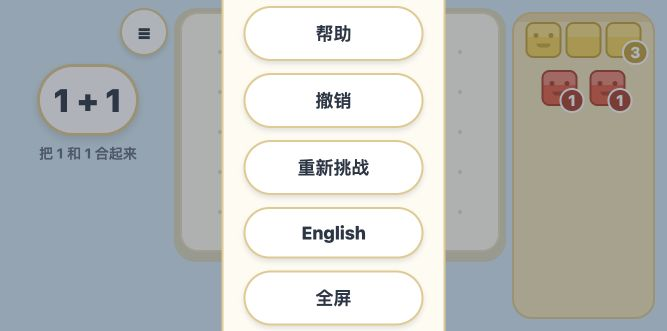

# 新版实际试玩与复审（2026-10-14）

结论：上一轮主要问题已得到实质修复，两章 19 关能够在浏览器实际操作中完整走通。可以进入家长陪同的儿童试玩阶段；先修横屏菜单，再提高任务提示与总量表达的清晰度。

## 实际运行与范围

- 重新构建当前源码，使用 `PORT=8791 pnpm serve:web` 提供静态产物，地址为 http://localhost:8791 。
- 使用 Codex 内建浏览器的 click / drag 实际操作，没有派发合成 pointer 事件、没有修改 pointer capture、没有通过脚本填充存档或直接完成关卡。
- 从空进度起顺序玩完数字岛 12 关和加法岛 7 关，地图显示 12/12 和 7/7。
- 浏览器交互为鼠标/自动化输入，不等同于真机触摸。没有听取或录制语音，因此不对实际发声、口音、音频解锁及重复播报作真机验收结论。
- 主试玩尺寸 390×844；游玩中切换到 844×390 再切回；另外检查了 375×553 与 667×331。
- lint、typecheck、Web export 均通过；34 个 suite、436 个测试全部通过，覆盖率门禁通过。此次浏览器 warn / error 日志为空。
- 未改动应用源代码。新增本报告和截图；构建、覆盖率命令更新生成文件。

## 已在实际操作中确认的改进

1. 单块数量、方阵、转角、长条和较大造型均能正常完成。
2. 10 的关卡搬出一个五块伙伴后，另一组位置与大小不变，原位置保留组轮廓。12 与 17 的所有材料在主试玩尺寸中可见，能取出并完成。
3. 十块伙伴可按顺序逐块点击，显示 1–10 与“再数一遍”；点数完成后重置计数可继续操作。
4. 菜单关闭后首个积木点击能计数。
5. 第一关刷新恢复了正确作品与下一站入口，点数轮次重新开始；完整进度刷新后也保留。
6. 十块正确作品在游玩中切换横屏再切回，作品及点数标记保留。
7. 1+1、2+1、2+2、3+2、4+1、3+4 均能完成，正确状态显示完整算式。
8. 2+2 两组分开放置不通过，接边后通过。自由和 Boss 放单个五块伙伴不通过，归还后换成 3+2 可通过，显示实际组合 `3 + 2 = 5`。
9. 1+1 点击再玩一次清空作品、恢复未匹配显示，保留已完成站的重新挑战入口。
10. 最终关把一组拖到另一组占用位置被拒绝；归还一组后取消正确状态；撤销后恢复正确算式与按钮。
11. 切换中英文后玩法继续正常。家长区显示正常存档状态。

存储拒绝、读取超时、异常存档局部修复及 reset 竞争主要由现有自动化测试和源码审查支持；本轮没有在浏览器里注入故障重新验证。不要与上面的实际操作结果混为一谈。

## 新发现：横屏菜单超出视口（P1）

位置：`src/screens/LevelScreen.tsx:422–423`，菜单渲染部分。

复现：完成 ch2-n1，点击再玩一次，再打开菜单，切到 667×331。已完成站有 7 个菜单按钮，卡片按固定间距纵向排列、居中，没有高度限制或滚动容器。

实际测量：“继续”按钮 y=-61.25、height=55，整个按钮位于屏幕上方；“地图”按钮 y=337.25、height=55，整个按钮位于屏幕下方。屏幕高仅 331。界面没有可见的独立关闭按钮；可通过其他菜单操作关掉，但正常继续和回地图的路径不可用。844×390 也不足以容纳同样的菜单。

建议：菜单使用受可用高度约束的可滚动区域，关闭入口固定可见；也可以在横屏采用紧凑双列。结合 safe-area 检查未完成、已完成、中英两种语言的菜单，每个操作都要能到达。验证要覆盖打开菜单后的实际 UI，不能只检查舞台几何。

## 次要代码问题：视觉庆祝仍可能被重排重新触发（P2）

位置：`src/blocks-ui/juice.ts:13–21`、`src/blocks-ui/Stage.tsx:79`、`src/screens/LevelScreen.tsx:180–188`。

源码显示 useHop 同时依赖成功 tick 和对象排序 index。成功后 tick 非零，移动对象改变行列排序使 index 改变，effect 会再次运行，即使没有新的 solvedNow。重新挑战也没有清零 celebrateTick；工作台对象重新挂载时会收到旧的非零 tick。

此项为代码路径审查结论；没有用动画事件录制或逐帧截图做独立验收。成功语音的触发已经改为 solvedNow，不应把这一项描述成语音重复问题。

建议：动画消费明确的新成功事件，index 只用于该事件的延迟；每轮重新挑战重置相关状态，避免旧事件在重排或新挂载对象上重播。

## 体验评价与下一步

### 任务表达

形状题的参考每格只有 11px，整体 2×2 或转角非常小；造型条件对四岁孩子不够醒目。建议加大参考，将轮廓放到工作台附近，并允许点击重播提示。不用占据整个舞台，也不必常驻品牌顶栏。

数量题和加法的错误摆法通常只是不出现成功反馈；孩子未必知道原因。帮助藏在 ≡ 菜单里的文字按钮，当前需要成人解释。建议提供清楚的小灯泡/喇叭入口，提示时把文字或对应伙伴轻量高亮，避免只能依赖语音。

### 总量表达

加法算式已经补上，这是明显改进。不过合体后两个伙伴仍各有脸和数字标签，标签靠近相邻组或点数序号时信息较密。建议保留来源颜色和组边界，增加短暂总量高亮或整体轮廓，把“两个部分组成一个总量”表达得更明确。

10 / 12 / 17 数量题的目标正好由给定握把构成，搬出几个现成伙伴就能过关。点数现在可以做，但不是过关必需。不要将通关自动理解为掌握数量；试玩时观察孩子是否愿意点数、能否表达总量、改变排列后是否仍知道数量。默认不把所有关卡强制变为逐块点完才能过关。

### 地图和练习

实际从最终关回地图后，视野仍在数字岛开头，当前站在第二岛下方不可见；建议滚动定位当前站或显示清楚的“继续第 X 站”。

家长选择章节仍缺失，简单加法仍必须先完成 17。建议家长区能直接选择一小组练习内容，儿童地图保留默认进阶。

19 关后缺少章节完成的明显收尾。可以加一句简短祝贺和“换一种摆法 / 再玩某章”，无需复杂成就系统。

### 验证优先级

1. 修横屏菜单，并补实际界面响应式检查。
2. 限定庆祝动画事件，改善形状参考及帮助入口。
3. 真机 Safari 试玩：首次语音、真实触摸、地址栏收缩、拖动中断、添加到主屏幕及刷新恢复。
4. 家长陪同儿童玩代表关卡：1、4 方阵、3 转角、10、2+2、自由和 5、3+4。观察任务理解、拖拽成功率、点数意愿和总量表达，不以速度或自动通关评价能力。

现在不需要继续大规模扩题。现有内容足以验证核心体验，下一轮应围绕“孩子能否自己看懂、操作、表达”收敛。
